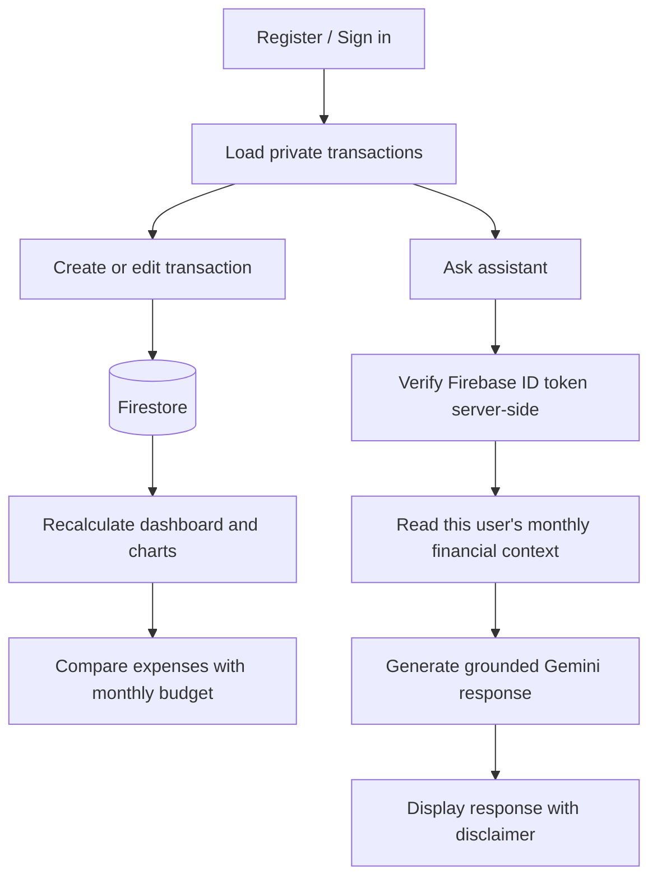

# SpendWise AI — AI-Powered Personal Expense Tracker

SpendWise AI is a full-stack personal finance application for recording income and expenses, managing monthly budgets, exploring financial trends, exporting transactions, and asking a Gemini-powered assistant questions grounded in the signed-in user's actual records.

> **Important:** This repository is delivered as a complete application source package. Firebase and Gemini are external services and require your own project credentials. They are not included in this ZIP. No fake credentials or fabricated service connection are provided.

## Features

- Firebase email/password registration, login, logout, password reset, and persistent auth.
- User-scoped Firestore transaction CRUD.
- Monthly budgets, utilization, remaining amount, and threshold alerts.
- INR dashboard and financial summaries.
- Responsive charts (Recharts) for monthly income/expenses, category split, and trends.
- Transaction search, category/type/date filters, and filtered CSV export.
- Gemini AI assistant through a server-side Vercel function; server verifies Firebase ID tokens and reads the authenticated user's records.
- Profile settings, loading/error/empty states, confirmation before deletion, and mobile layout.
- Unit tests for financial calculations and CSV escaping.

## Stack

React + TypeScript + Vite, Tailwind CSS, Firebase Authentication, Cloud Firestore, Vercel serverless functions, Gemini API, Recharts, Vitest, React Testing Library.

## Requirements

- Node.js 20 or newer (recommended: current LTS)
- npm
- Firebase account and project
- Gemini API key from Google AI Studio
- Vercel account for deployment (optional for local frontend; required for deployed AI API)

## Local setup

1. Unzip the project and open a terminal in the `SpendWise-AI` folder.
2. Install packages:

   ```bash
   npm install
   ```

3. Create your environment file:

   ```bash
   cp .env.example .env
   ```

   On Windows PowerShell:

   ```powershell
   Copy-Item .env.example .env
   ```

4. Firebase setup:
   - Create a Firebase project in the Firebase Console.
   - Add a Web App and copy its config into the `VITE_FIREBASE_*` fields in `.env`.
   - In **Authentication → Sign-in method**, enable **Email/Password**.
   - Create a **Cloud Firestore** database.
   - In Firestore Rules, deploy the contents of `firestore.rules`.
   - Add a Firebase Admin service account: Firebase Console → Project settings → Service accounts → Generate new private key.
   - Keep the downloaded service-account JSON private. For local Vercel function development, add its minified JSON to `FIREBASE_SERVICE_ACCOUNT_JSON` in `.env`. Never commit it.

5. Gemini setup:
   - Create an API key in Google AI Studio.
   - Put it in `GEMINI_API_KEY` (server-side only; **do not** prefix with `VITE_`).
   - Optionally set `GEMINI_MODEL`; default is `gemini-2.0-flash`. Confirm model availability for your account before deployment.

6. Run the app:

   ```bash
   npm run dev
   ```

   Vite runs the UI. To test Vercel serverless functions locally, install Vercel CLI and use:

   ```bash
   npx vercel dev
   ```

   The AI endpoint is `/api/assistant`. The Vite dev server alone does not execute Vercel API functions; use `vercel dev` for the full local AI workflow.

## Environment variables

See `.env.example`. Frontend Firebase variables are intentionally `VITE_` prefixed and visible to the browser; they are Firebase's public web-app configuration, not privileged service-account credentials. The Gemini key and Firebase Admin service account are server-only secrets.

For Vercel deployment, configure all variables in **Project → Settings → Environment Variables**:
- `VITE_FIREBASE_API_KEY`
- `VITE_FIREBASE_AUTH_DOMAIN`
- `VITE_FIREBASE_PROJECT_ID`
- `VITE_FIREBASE_STORAGE_BUCKET`
- `VITE_FIREBASE_MESSAGING_SENDER_ID`
- `VITE_FIREBASE_APP_ID`
- `GEMINI_API_KEY`
- `GEMINI_MODEL` (optional)
- `FIREBASE_SERVICE_ACCOUNT_JSON`

For the Admin JSON value, paste the complete service-account JSON as a single JSON string. Ensure newlines inside the private key are escaped as `\\n`. Use a least-privilege service account where possible and rotate keys if exposed.

## Firestore schema

```text
users/{uid}
  transactions/{transactionId}
    userId, type ("income"|"expense"), amount (number), category, description,
    date ("YYYY-MM-DD"), createdAt, updatedAt?
  budgets/{YYYY-MM}
    month ("YYYY-MM"), amount (number), updatedAt
  settings/profile
    displayName, email, updatedAt
```

`firestore.rules` limits each user's documents to their authenticated UID. Deploy and test rules in Firebase Emulator Suite or Firebase Console before real use. Admin SDK server functions bypass Firestore rules, so the API verifies the Firebase ID token and derives the UID from that token; never accept a client-supplied UID for AI access.

## Architecture

```mermaid
flowchart LR
  U[User / Browser] --> R[React + TypeScript UI]
  R --> F[Firebase Authentication]
  R --> D[Cloud Firestore: users/{uid}]
  R -->|ID token + question| V[Vercel API /api/assistant]
  V --> A[Firebase Admin: verify ID token]
  A --> D
  V --> G[Gemini API]
  G --> V --> R
```

## Workflow



## Database access/security notes

- Browser access uses Firebase Auth and Firestore security rules.
- User data is stored under `users/{uid}`.
- AI API calls require a valid Firebase ID token. The backend derives the UID from the verified token.
- The server does not trust a UID sent in request JSON.
- Gemini key and Admin credentials must remain server-side.
- The app does not send password, Firebase service-account credentials, or unnecessary profile information to Gemini.
- Financial context is sent to Gemini to answer the user’s question. Avoid entering highly sensitive personal information in transaction descriptions.
- AI insights are informational, not professional financial advice.

## Testing and quality checks

```bash
npm run typecheck
npm run lint
npm test
npm run build
```

The included Vitest tests cover financial aggregation, balance, budget edge cases, transaction validation, and CSV quoting. Authentication, Firestore rules, and Gemini integration require configured Firebase credentials and should additionally be tested in a Firebase Emulator/real staging project and with Vercel's local runtime.

## Deployment to Vercel

1. Push this folder to a private or public GitHub repository (never commit `.env` or service-account JSON).
2. Import the repository into Vercel.
3. Set the environment variables listed above in Vercel.
4. Set the project framework to Vite (Vercel usually detects it), build command `npm run build`, output directory `dist`.
5. Ensure `api/assistant.ts` is deployed as a Vercel Node.js serverless function.
6. Deploy Firestore rules separately in Firebase.
7. Test registration, transaction CRUD, budget save, charts, CSV export, and AI endpoint in the deployed URL.

## 5–10 minute demonstration

1. Register or sign in.
2. Add a sample income transaction (e.g. stipend).
3. Add 3–5 expenses in different categories.
4. Set a monthly budget.
5. Show dashboard stats and category charts.
6. Ask the assistant: “Which category costs me the most this month?”
7. Show the monthly analytics.
8. Export transactions to CSV.

Use clearly labeled demo data in a test account only. Do not use fabricated values in production.

## Limitations and future scope

- Currency is currently INR only.
- AI answers are limited by the Gemini model, quotas, and network availability.
- The UI's date filtering and budget are monthly; recurring bills, multi-currency, receipt OCR, bank sync, and shared household budgets are not implemented.
- Add a Firebase Emulator integration suite, stronger rate limiting/abuse controls, and server-side schema validation before a high-traffic public launch.
- Consider a dedicated rate-limit store (e.g., Redis/Upstash) if exposing the AI endpoint publicly.

## Author

- **Name:** [Your Name]
- **College / Internship:** [Your Institution / Internship Program]
- **GitHub:** [Your GitHub Profile]
